<p align="center">
  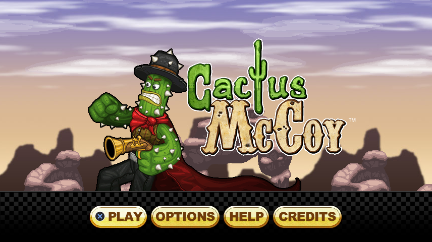
</p>

# CactusVita

**An unofficial, native PlayStation Vita port of the Flash game *Cactus McCoy* (Flipline Studios), written in C++17 with SDL2.**
**Currently waiting on a publication approval response from Flipline Studios.**

Not an emulator and not a Flash player: the game's logic (movement, weapons, every enemy and boss, every room object, scoring,
challenges, badges, save data) was re-implemented in C++ by reading the game's decompiled ActionScript, and it runs at the original's
30 steps per second on the Vita's own hardware. The tools in this repository rebuild the game's data and pictures from **your own copy** of
the original game, so the repository itself contains no Flipline material (see [Legal](#legal)).

> **Status:** playable at stable 60 FPS from the first area to the ending on a real PS Vita PCH-1004. This repository is version **02.55**; 
> Not tested:
> other Vita models PCH-100x, PCH200x, PSTV. It is a hobby project, shared in the hope
> that it is useful to other homebrew developers and to fans of the game.

<p align="center">
  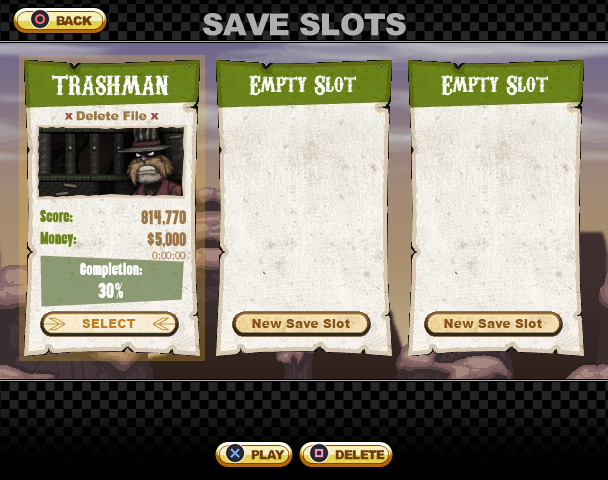
  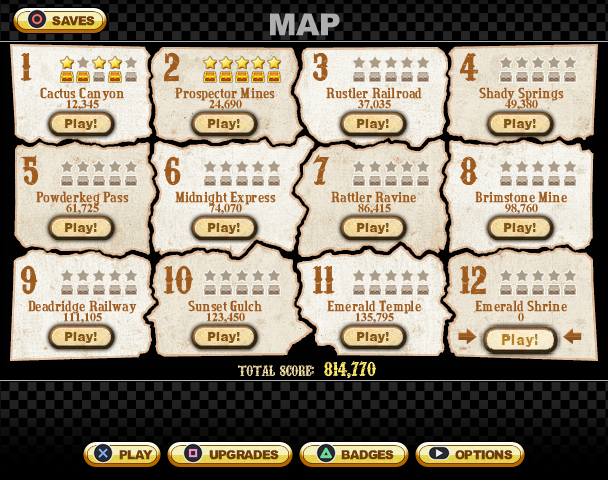
  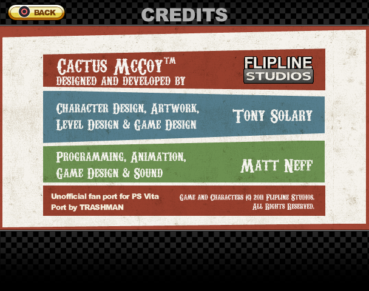
</p>

<p align="center">
  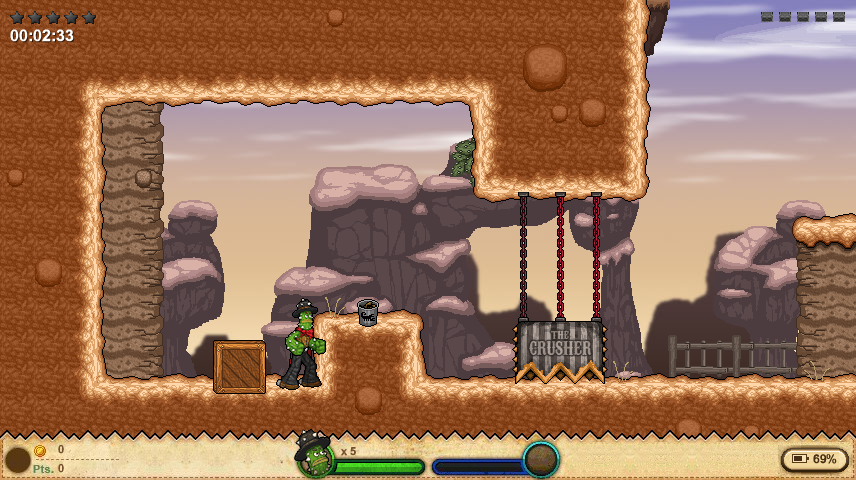
  <br><em>16:9 mode: you see more of the room, and the HUD and menus are re-laid out for the Vita's screen.</em>
</p>

## Table of contents

- [What you get](#what-you-get)
- [What is *not* in this repository (and why)](#legal)
- [Quick start](#quick-start)
- [Controls](#controls)
- [How the port works, in one page](#how-the-port-works-in-one-page)
- [Differences from the Flash original](#differences-from-the-flash-original)
- [The debug menu](#the-debug-menu)
- [Repository layout](#repository-layout)
- [Documentation](#documentation)
- [Contributing](#contributing)
- [Credits](#credits)

## What you get

| | |
|---|---|
| **The whole game** | 12 areas / 74 rooms, all enemy types and the end-of-level boss, 59 weapons (35 melee, 24 guns and throwables), every room object (crates, TNT, chickens, statues, flame jets, floating bombs, doors and gates that script fights ...), the opening and ending cutscenes |
| **Progress** | 3 save slots, the upgrade shop (5 attacks x 6 levels), 60 area challenges, 80 badges, treasure chests, high scores and best times, the original's score formulas |
| **Original look** | HUD, menus, map, area sheets, fonts and animations are cut out of the game's own `assets.swf` (menus have 4:3 and 16:9 layouts) |
| **Vita-specific** | native resolution (4:3 original or **16:9 fills the screen**), the front touch screen in menus, battery read-out in the HUD, **Save and Quit** in the middle of a level, standby handling, the system keyboard for names, look-around on the right stick |
| **Smooth** | logic at 30 Hz, drawing at 60 Hz, pictures streamed by a background thread, sprite sheets cropped from 180 MB to 62 MB, saves written by a writer thread |
| **For developers** | SDL-free game logic that is **unit-tested with just g++** (35 test programs, thousands of checks that also play through every real room), a fully scripted data pipeline, and a built-in on-screen debug menu (cheats, teleport, spawn anything, hit boxes) |

<p align="center">
  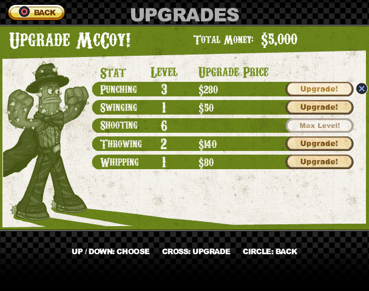
  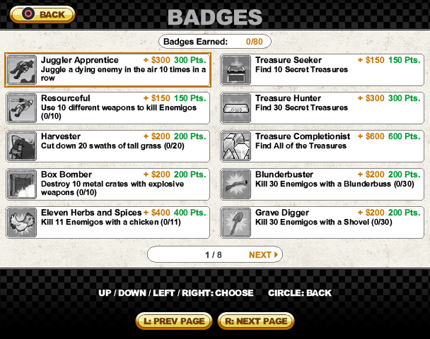
  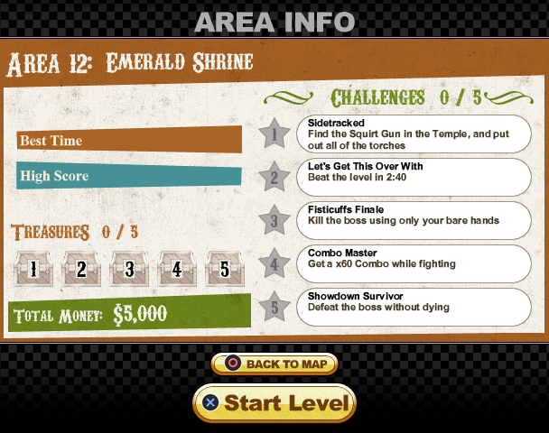
</p>

## Legal

*Cactus McCoy* is a game by **Flipline Studios** (design and development: Tony Solary, Matt Neff). All of its artwork, music, sounds,
level data, text and characters belong to them. **This repository does not contain any of it** - no pictures, no sounds, no level files,
no story pages, and no data tables generated from them. It contains only the new source code of the port, the scripts that convert your
own copy of the game, tests, and documentation.

That means a normal `git clone` does not give you something you can build and play. You need to bring the original game (a Flash `.swf`
that you obtained yourself) and run the conversion tools on it; [docs/BUILDING.md](docs/BUILDING.md) walks through it. Please do **not**
upload the generated files, a finished `.vpk`, or screenshots beyond what is already here to places where they could be downloaded by
others. See [NOTICE.md](NOTICE.md) for the full statement and for what to do if you are a rights holder.

The screenshots in this repository show the port running with the game's own pictures; they are included for documentation, in the same
way a review or a wiki would show them.

**Currently waiting on a publication approval response from Flipline Studios.**

## Quick start

You need: a PS Vita with custom firmware (HENkaku / Ensō; Vita3K should work but has not been tried), a Linux / WSL machine with
[VitaSDK](https://vitasdk.org/), `python3` with `Pillow` and `numpy`, `ffmpeg`, `cmake` and a C++17 compiler - and the original game.

```sh
git clone https://github.com/<you>/CactusVita.git
cd CactusVita

# 1. Decompile your own copy of the game's .swf with JPEXS Free Flash Decompiler (FFDec):
#    "Export all parts" so that  <export>/scripts/cactusGame/  and  <export>/scripts/_assets/  exist.

# 2. Generate the data and pictures from it (a few minutes):
sh tools/regenerate_all.sh <export>/scripts

# 3. Run the tests (optional, needs only g++):
sh tests/run_tests.sh

# 4. Build the VPK:
cmake -S . -B build && cmake --build build
#    -> build/CactusVita_02_55.vpk   (install it with VitaShell)
```

Saves, settings and logs go to `ux0:data/CactusVita/`. Full details, troubleshooting, the desktop build for quick testing and what to do
about the `vita-elf-create` padding error are in **[docs/BUILDING.md](docs/BUILDING.md)**.

## Controls

| Action | PS Vita | Keyboard (desktop build) |
|---|---|---|
| Move / duck | D-pad or left stick (Down = duck) | arrow keys |
| Jump (hold for higher) | Cross | Space / Z |
| Attack / shoot / throw | Square | X |
| Drop the weapon | Circle | C |
| Drop through a one-way floor | Down + Cross | Down + Space |
| Aim up / diagonal | Up (+ direction) with Square | same |
| Pick up a weapon, lift a crate or statue | Down (duck over it) | Down |
| Look around | right stick | keypad 8 / 4 / 2 / 6 |
| Pause menu | Start | Enter |
| Menus: choose / accept / back | D-pad / Cross / Circle, **or the touch screen** | arrows / Space / C |
| Debug menu (needs the secret save name) | Select, or L + R | F1 |
| Quit the app | Start + Select | Esc |

Touch is used in the menus and cutscenes only, never during play. The in-game *How to play* screen explains the rest.

<p align="center">
  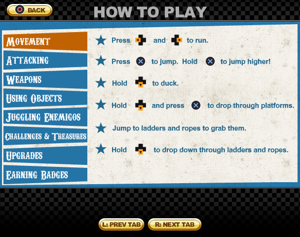
  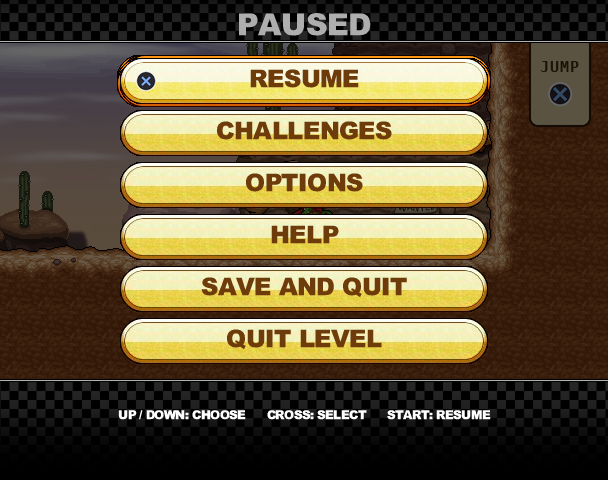
  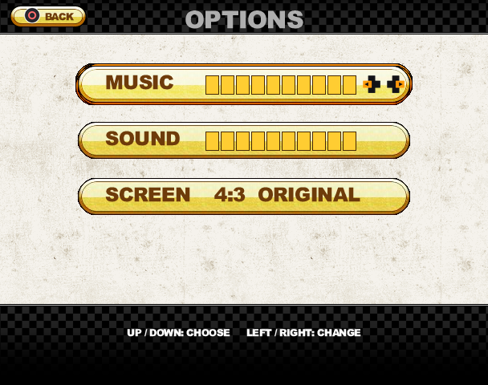
</p>

## How the port works, in one page

1. **Decompile.** FFDec turns the Flash file into ActionScript source (`cactusGame/*.as`) and extracts the pictures and sounds (`_assets/`).
2. **Extract.** Python scripts in `tools/` read the ActionScript and write C++ tables (`src/*_data.h`: animation cycles, weapon and enemy stats,
   item and object definitions, the 60 challenges and 80 badges, tile properties). The level maps are stored in the original *as a picture*
   (an XML text drawn into a bitmap, one colour per character): `tools/decode_levels.py` reads it back, `tools/export_levels.py` packs it into a
   compact `rooms.bin`. A small SWF reader (`tools/swf_read.py` / `swf_render.py`) cuts the HUD and menu art out of `assets.swf`.
3. **Port the logic.** The game code in `src/` is a function-by-function port of the ActionScript, keeping its order of operations, its constants
   and even its quirks (a comment next to each piece names the `.as` file it comes from). It has no SDL dependency, so it compiles and is
   tested on any machine.
4. **Draw and play.** A thin SDL2 layer (`Viewer`, `Flow`, `main.cpp`) draws the tiles, sprites, HUD and menus, mixes audio with a small
   software mixer, reads the pad and touch screen, and runs the fixed 30 Hz loop.
5. **Check.** Unit tests replay the original's behaviour (a punch lasts N frames, a rocket flies 8 directions ...), and "random play" tests walk
   every real room and play every real fight looking for broken invariants.

More depth: [docs/PORTING_NOTES.md](docs/PORTING_NOTES.md) (the method, the tools, the lessons) and [docs/ARCHITECTURE.md](docs/ARCHITECTURE.md) (the code).

## Differences from the Flash original

The goal is to play like the original; where it deliberately differs it is to suit a handheld. The short version (full list with reasons in
**[docs/CHANGES_FROM_ORIGINAL.md](docs/CHANGES_FROM_ORIGINAL.md)**):

- Gamepad + touch controls with new button tutorials on the training signs; no mouse buttons for Menu / Pause / Mute.
- **Save and Quit** in the middle of an area (the Flash game could only save between areas).
- **16:9 option** that really shows more of the room and re-lays out the HUD and menus.
- Battery percentage in the HUD, standby-safe pausing, system-keyboard name entry.
- Look around with the right stick, faster start-up and no loading hitches, steadier frame pacing.
- Fixes for things that were off in the early port or in the original's edge cases (carrying through doors, "Boulder Bane" counting, spawner and
  off-screen rules in widescreen ...).
- An on-screen debug menu.
- Fixed bullet hitboxes (enemies right in front of guns would not get hit by bullets in the original)

<p align="center">
  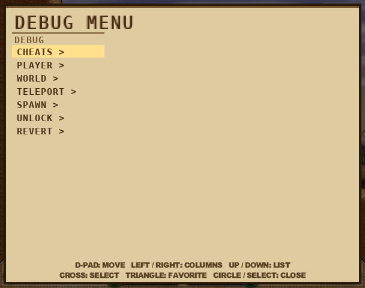
  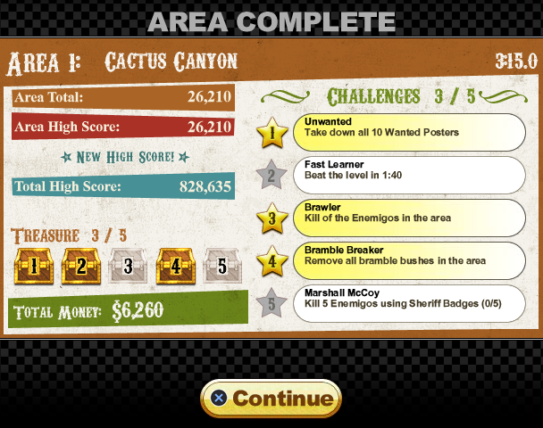
</p>

## The debug menu

Create a save slot named **notTRASHMAN**. The pause menu then has *Debug Options*; switch the debug menu on, and **Select** (or **L + R**) opens a
menu with cheats (one punch, god mode ...), player and world speed, teleport to any room (with a free-camera spot picker), spawn any weapon /
enemy / object, hit-box display, unlock everything, and a *Revert* column that undoes only what a cheat gave. It is part of the release on
purpose: it is how the game was tested, and it makes it easy for developers to reach any room. See [docs/DEBUG_MENU.md](docs/DEBUG_MENU.md).

## Repository layout

```
CMakeLists.txt        Vita build (VITASDK present) or a desktop SDL2 build for quick tests
src/                  the port: game logic (SDL-free) + the SDL2 app layer (viewer_*.cpp, main.cpp)
tests/                headless unit tests (run with: sh tests/run_tests.sh) and a few image/pose dump helpers
tools/                the data pipeline: decompiled ActionScript / SWF  ->  C++ tables, level files, pictures, sounds
docs/                 BUILDING, ARCHITECTURE, PORTING_NOTES, CHANGES_FROM_ORIGINAL, DEBUG_MENU, TESTING, ROADMAP, DEVELOPMENT_LOG
.github/              issue and pull request templates, a small lint workflow
```

Generated at build time and **never committed** (listed in `.gitignore`): `assets/`, `data/`, `assets_src/`, `build/`, and the generated tables
`src/*_data.h`, `src/tileprops.h`, `src/menu_data.h`, ...

## Documentation

| Document | What it covers |
|---|---|
| [docs/BUILDING.md](docs/BUILDING.md) | Requirements, exporting the game, running the pipeline, building the VPK and the desktop version, troubleshooting |
| [docs/ARCHITECTURE.md](docs/ARCHITECTURE.md) | Every module, the main loop, data flow, threading, save format, conventions - start here to read the code |
| [docs/PORTING_NOTES.md](docs/PORTING_NOTES.md) | How a Flash game was ported, the tools used, how the data is recovered, performance and memory work, pitfalls on the Vita |
| [docs/CHANGES_FROM_ORIGINAL.md](docs/CHANGES_FROM_ORIGINAL.md) | Quality-of-life changes and every deliberate difference from the Flash game |
| [docs/DEBUG_MENU.md](docs/DEBUG_MENU.md) | How to unlock and use the debug menu |
| [docs/TESTING.md](docs/TESTING.md) | The test suite, how to run it, how to write a test, how screenshots can be made headlessly |
| [docs/ROADMAP.md](docs/ROADMAP.md) | What is done and what is open |
| [docs/DEVELOPMENT_LOG.md](docs/DEVELOPMENT_LOG.md) | The full version-by-version diary (historical) |
| [CHANGELOG.md](CHANGELOG.md) | Release notes |

## Contributing

Bug reports with a short description and, if possible, the `perf_log.txt` or `standby_log.txt` from `ux0:data/CactusVita/` are very welcome;
code contributions too - read [CONTRIBUTING.md](CONTRIBUTING.md) first (the short version: keep the logic SDL-free, add a test, name the
ActionScript file you ported from, and never commit anything that belongs to Flipline).

## License and credits

The source code of this repository is released under the **GNU General Public License v3.0 or later** [LICENSE](LICENSE). That license covers only the code, tools and documents
written for the port; it grants **no rights** to the game *Cactus McCoy* or anything derived from its assets (see [NOTICE.md](NOTICE.md)).

Built with [VitaSDK](https://vitasdk.org/), [SDL2](https://libsdl.org/) / SDL2_image, [JPEXS Free Flash Decompiler](https://github.com/jindrapetrik/jpexs-decompiler)
(used to read the original), Python with Pillow and numpy, FFmpeg.

**Cactus McCoy** - Flipline Studios (Tony Solary, Matt Neff). This port is an unofficial fan project and is not affiliated with or endorsed by them.
If you like the game, play and support their other games.

Made by **trashman**. Developed with AI assistance. Found a bug or have an idea? [Open an issue](../../issues).
